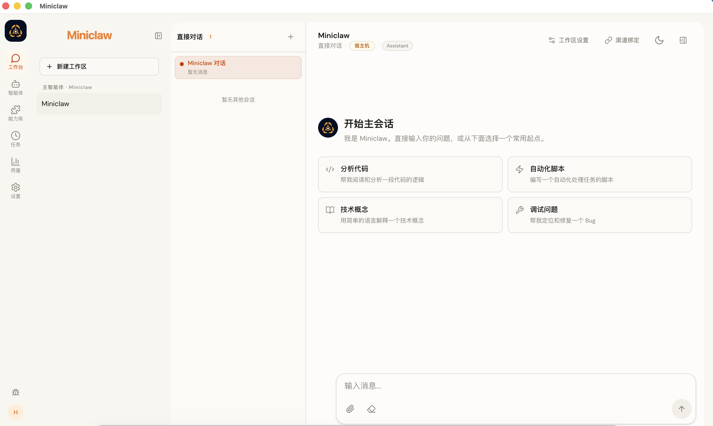
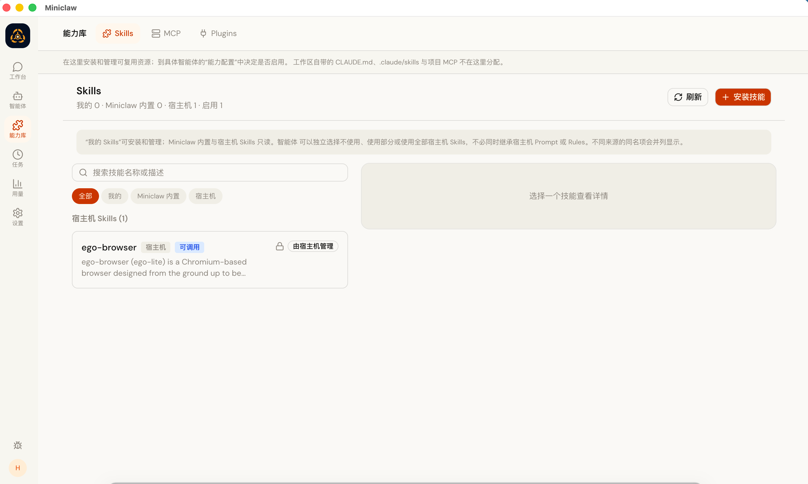
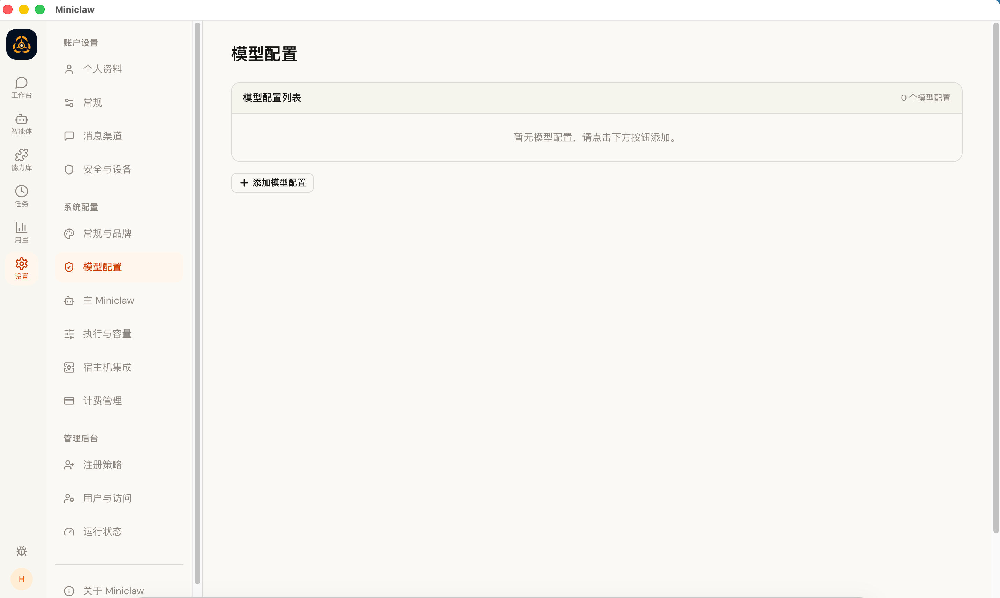

# CKQClaw

<p align="center">
  
</p>

<p align="center">
  <strong>自托管、Pi Agent 驱动的多渠道智能体工作台</strong><br />
  把 Agent、工作区、记忆、工具、渠道与自动化任务组织在同一个可控的运行环境中。
</p>

<p align="center">
  <a href="https://github.com/ckq184/ckqclaw">GitHub</a> ·
  <a href="docs/API.md">API</a> ·
  <a href="docs/ACL-MATRIX.md">访问边界</a> ·
  <a href="SECURITY.md">安全策略</a>
</p>

> 一句话：聊天界面让你向 Agent 提问；CKQClaw 让 Agent 拥有长期运行的工作区、可审计的能力边界，以及能够被 Web 与消息渠道共同使用的运行时。

## 产品定位

CKQClaw 是一个面向个人的自托管 AI Agent 工作台。它不是一个只保存聊天记录的对话框，而是把以下对象放在同一个产品模型中：

- Agent 身份、模型策略与能力配置。
- Workspace 文件、执行环境、访问边界和渠道绑定。
- 持久化 Session、流式输出、取消、恢复和后台运行。
- Workspace 级 Memory、Skills、MCP 与 Subagents。
- Web、飞书、QQ、微信等入口。
- Cron、间隔和一次性任务，以及任务运行历史、通知与恢复。

CKQClaw 采用本地优先和显式集成的思路：数据库、工作区元数据、会话状态和配置由自己的服务管理；模型、消息渠道、Docker 与外部工具都作为可配置边界接入。作为个人 Agent 工作台，产品按单账号使用，不提供注册、账号管理与多人协作界面。

## 界面与体验

工作台围绕 `Agent → Workspace → Runtime Session` 组织信息。左侧导航提供工作台、智能体、能力库、任务和设置入口；进入工作台后，可以在同一个界面中切换 Agent、Workspace 和对话上下文。

下面是当前 Web 工作台的实际界面：

<p align="center">
  
</p>

<p align="center">
  <em>工作台：在同一个界面中管理 Agent、Workspace、Session 与对话。</em>
</p>

<p align="center">
  
  
</p>

<p align="center">
  <em>能力库与模型配置：把 Skills、MCP 和 Provider 配置放在清晰的管理边界内。</em>
</p>

新的 CKQClaw 图标用于 Web/PWA 应用：

<p align="center">
  
</p>

## 核心功能

### Agent 与 Workspace

- 用 Agent Profile 保存身份、模型、思考级别、Skills、MCP 与执行策略。
- 每个 Workspace 拥有独立的文件、Session、Memory、渠道绑定和执行边界。
- Home Workspace 与自定义 Agent 分层管理，支持创建、重命名、重建、清空和删除。
- 支持 Host 与 Docker 两种执行方式；需要隔离的任务可以在 Agent Runner 容器中运行。

### Pi Agent Runtime

- 基于 Pi Agent Runtime 提供 prompt、流式输出、工具调用、Session 持久化与恢复。
- 支持 abort、follow-up、原生 compaction 和持久化 JSONL Session。
- 复用 CKQClaw 已有的 MCP capability handler，并映射为稳定的 `mcp__ckqclaw__*` 工具。
- Subagents 通过 Pi extension 与显式的 spawn/stop 生命周期桥接。
- Runtime 不会静默假装拥有缺失能力；尚未接入 Pi 的 Web Search/Web Fetch 能力会保持明确不可用。

### Memory 与上下文

- Memory 按 Workspace 隔离，不在不同工作区之间隐式共享。
- 支持事实、偏好、决策和经验等知识类型，以及搜索、编辑、忘记和版本历史。
- 写入使用 revision 与 compare-and-set，避免并发编辑覆盖彼此的修改。
- 每条 Memory 可记录来源 Session、来源类型、观察时间和变更历史，便于回溯 provenance。
- Runtime 只注入当前 Workspace 允许使用的记忆，不把平台身份约束当作普通用户记忆。

### Skills 与 MCP

- 内置、宿主机、项目、用户、Workspace 层级的 Skills 统一解析。
- 能力库集中展示 Skills 与 MCP 的可用状态、依赖和能力预览。
- Agent 运行前会计算有效能力 Manifest，并把 Skills、MCP、Memory、Workspace 与渠道上下文按策略注入。
- 路径穿越、符号链接逃逸、越权 Workspace 与未授权 capability 会在边界层拒绝。
- 外部 MCP 服务器可经 `/mcp-servers` 自行配置。

### 渠道与自动化

- 支持将消息渠道绑定到指定 Workspace 或 Session，并按工作区、群聊、话题和 owner 规则进行访问判断。
- 支持飞书、QQ、微信等消息入口。
- Scheduler 支持 Cron、固定间隔和一次性任务，提供立即运行、暂停、取消、运行历史和结果投递。
- 后台任务、Subagent 和渠道回复都沿用同一套 Workspace、Session、owner 与访问上下文。

## 工作原理

```text
Web Client / Message Channels
                         │ HTTP + WebSocket / Channel Adapters
                         ▼
                CKQClaw Backend
        Auth · API · Queue · Scheduler · ACL
                         │
        ┌────────────────┼─────────────────┐
        ▼                ▼                 ▼
   Workspace         Capability         Channel
   Session           Registry            Binding
   Memory            Skills/MCP          Delivery
                         │
                         ▼
                 Pi Agent Runner
                   Host / Docker
                         │
                         ▼
                Pi Agent Runtime
          Tools · Extensions · Subagents
```

核心边界保持清晰：Backend 负责认证、持久化、队列、调度、渠道和授权；Pi Runner 负责 Agent 执行；Workspace 决定文件与运行边界；Web Client 只负责界面。

## 快速开始

### 环境要求

- Node.js 20 或更高版本
- npm
- GNU Make
- 如果使用容器执行模式，需要 Docker

### 启动 Backend 与 Web Client

```bash
git clone https://github.com/ckq184/ckqclaw.git
cd ckqclaw

npm install
npm --prefix web install
npm --prefix container/agent-runner install

# 首次安装或依赖更新后构建 Backend、Web 与 Agent Runner
npm run build:all

# 启动生产式本地服务
npm start
```

默认地址：<http://127.0.0.1:3001>

开发模式可以直接启动 Backend 和 Vite Web Client：

```bash
npm run dev:all
```

首次进入时完成账号初始化和 Provider 配置即可。Provider/渠道接入步骤现在可以选择“稍后设置”，跳过后仍可进入工作台，之后在设置中补齐模型和渠道配置。

Agent 容器镜像默认使用 `ckq184/ckqclaw-agent:latest`，可以通过 `CKQCLAW_CONTAINER_IMAGE` 或 `CONTAINER_IMAGE` 覆盖。

## 常用命令

| 命令                    | 说明                                                 |
| ----------------------- | ---------------------------------------------------- |
| `npm run dev:all`       | 启动 Backend 与 Vite Web Client                      |
| `npm run build:all`     | 构建 Backend、Web Client 与 Agent Runner             |
| `npm run typecheck`     | 检查 Backend TypeScript                              |
| `make typecheck`        | 执行 Backend、Web、Agent Runner 的完整类型与文档检查 |
| `npm test -- --run`     | 运行 Vitest 测试                                     |
| `make backup`           | 创建运行时数据备份                                   |
| `make restore FILE=...` | 恢复指定备份                                         |
| `make status`           | 查看 Backend、日志和 Docker 状态                     |
| `make stop`             | 停止当前端口上的 CKQClaw 服务                        |

## 配置入口

| 环境变量                  | 用途                             | 默认值                        |
| ------------------------- | -------------------------------- | ----------------------------- |
| `CKQCLAW_CONTAINER_IMAGE` | Agent Runner 使用的容器镜像      | `ckq184/ckqclaw-agent:latest` |
| `CONTAINER_IMAGE`         | 容器镜像的兼容覆盖项             | 同上                          |
| `WEB_PORT`                | Makefile 启动 Backend 使用的端口 | `3001`                        |

不要把 API Key、Session Cookie 或其他凭证写入命令行历史、截图或提交到仓库。远程部署时使用 HTTPS/WSS，并为反向代理、Cookie 和访问控制配置独立的安全边界。

## 执行与安全边界

- Backend 由 Node.js 运行，负责认证、API、WebSocket、队列、调度、渠道连接、Provider 和 SQLite 持久化。
- Docker 只隔离 Agent 执行环境，不替代 Backend 的授权层。
- Web Client 不直接读取文件、数据库或凭据；文件与宿主能力一律经 Backend API 提供。
- 登录会话、工作区归属、admin 角色和 Host 执行策略在服务端共同判定，不能因为已登录就自动越过执行边界。
- Memory、Skills、MCP 和 Scheduler 任务都继承 Agent、Workspace 与 Session 上下文。

更多访问边界见 [`docs/ACL-MATRIX.md`](docs/ACL-MATRIX.md)，安全问题请参考 [`SECURITY.md`](SECURITY.md)。

## 项目状态

CKQClaw 当前处于持续开发阶段。仓库已经包含：

- Pi Agent Runtime 生产执行路径与 runtime-neutral contract。
- Web Client。
- Agent Profile、Workspace、Session、Memory、Skills、MCP 和 Subagents。
- 个人 Agent 工作台的单账号登录、访问边界、owner 生命周期、调度任务和渠道接入。
- Host/Docker 双执行边界。

真实模型调用、Docker 执行、渠道连接和远程部署仍然依赖本地凭证、服务配置与运行环境；没有外部 Provider 时，可以先启动 UI、完成本地初始化，并在设置中稍后补齐配置。

## 路线图

### 近期

- 完善渠道 onboarding、运行监控和失败恢复提示。
- 持续收敛 Workspace、Memory、Skills 与 Scheduler 的产品文档。

### 长期

- 更丰富的 Agent/Provider 扩展模型。
- 可视化的运行轨迹、证据链与成本分析。
- 面向贡献者的能力注册、Skill 开发和渠道适配指南。

## 文档

- [`docs/API.md`](docs/API.md) — HTTP API、认证和主要资源接口
- [`docs/ACL-MATRIX.md`](docs/ACL-MATRIX.md) — 个人版访问边界：登录会话与 IM 侧访问控制
- [`docs/workspace-memory-v2.md`](docs/workspace-memory-v2.md) — Workspace Memory 的数据模型、版本与交互边界
- [`docs/runtime-migration.md`](docs/runtime-migration.md) — 从旧运行时到 Pi Agent Runtime 的迁移记录
- [`docs/PROMPT-SKILL-RUNTIME-TEST-PLAN.md`](docs/PROMPT-SKILL-RUNTIME-TEST-PLAN.md) — Prompt、Skill、Runtime 与 Agent Builder 验证计划
- [`SECURITY.md`](SECURITY.md) — 安全问题报告与处理策略

## 参与贡献

欢迎提交 Issue 与 Pull Request。提交前建议运行：

```bash
make typecheck
npm test -- --run
npm run build:all
```

如果改动了 UI 或交互流程，请附上截图或简短的视觉 QA 说明；前端不直接接触 SQLite、filesystem、credentials、Docker 和 shell/process。

## License

CKQClaw 使用 MIT License，详见 [`LICENSE`](LICENSE)。
